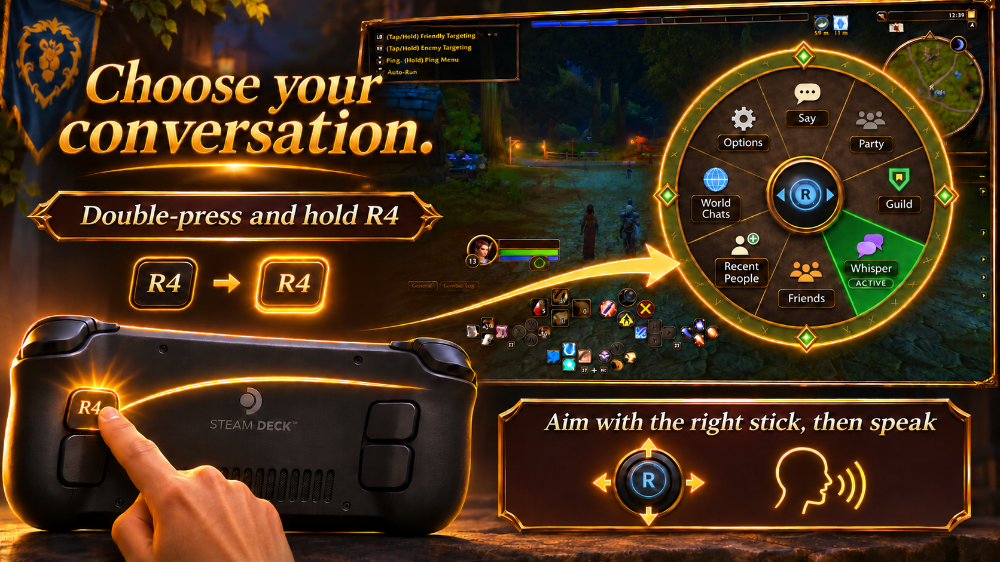

# My Steam Deck Gets Me

**Talk to your party without taking your hands off the Steam Deck.**

Hold **R4**, say “Anyone up for Deadmines?”, and let go. Your words appear as text in **WoW Forever’s in-game chat**. Use the right stick to pick a channel or a friend, fix a word with the D-pad, and choose when the message goes out. Speech recognition runs locally using the Deck’s built-in mic.

[Install on your Steam Deck](#install) · [See the controls](#how-to-play)



## How to play

| Gesture | What it does |
| --- | --- |
| **Hold R4**, speak, then release | Dictate to your last chat destination. The listening card shows where your message is going. |
| **Press R4 twice and hold the second press** | Open the destination wheel. Aim with the right stick to pick Say, Party, Guild, a whisper, or another destination. Keep holding R4 while you speak. |
| **Double-tap R4** while a message is waiting | Open the correction menu. Use the D-pad to select a word and cycle through alternatives or remove it. Hold **R4** to say the word again. |
| **Press A** or **tap R4** while a message is waiting | Send it now. Press **B** to discard it. |

Open **Options** on the wheel to send immediately, wait for you to press send, or use a **2-, 3-, or 5-second countdown**. The default countdown is 2 seconds.

## Install

You’ll need a **Steam Deck running SteamOS**, **WoW Forever** (the Classic-based World of Warcraft client) set up through Battle.net as a non-Steam game with Proton, and about **2 GB of free space**. Dictation is in English. The tool was tested on a Steam Deck OLED and can be used in Game Mode or Desktop Mode.

Switch to **Desktop Mode**, open **Konsole**, and run:

```bash
git clone https://github.com/yerenutku/my-steam-deck-gets-me.git ~/my-steam-deck-gets-me && bash ~/my-steam-deck-gets-me/install.sh
```

The installer sets up the SteamOS companion and the in-game addon. It also offers to configure Steam Input so the right stick can aim at the wheel without turning the camera. Launch WoW, wait for **Voice ready**, then hold **R4** and say something. [Full installation guide](docs/install.md)

## Recognition and privacy

Recognition uses an English speech model on the Deck’s GPU and a word list to help with WoW terms such as **Deadmines** and **Ironforge**. You can add your friends’ and guildmates’ names to `service/names.txt`. In testing on one Steam Deck OLED, text appeared about **one second** after releasing R4. [Benchmarks and test setup](docs/lab-report.md) · [Run the tests yourself](docs/run-the-tests.md)

Speech recognition runs locally. The tool keeps audio and transcripts for up to 200 recent dictations in `service/history/` on your Deck. You can delete those files any time.

## Credits and license

Built by a WoW player together with Claude (Anthropic). The project code is [MIT licensed](LICENSE).

- Speech recognition uses NVIDIA Parakeet unified-en 0.6B (CC BY 4.0), the [GGUF build by handy-computer](https://huggingface.co/handy-computer/parakeet-unified-en-0-6b-gguf), and [transcribe.cpp](https://pypi.org/project/transcribe-cpp/) on Vulkan.
- Pause detection uses Silero VAD (MIT) through sherpa-onnx (Apache 2.0).
- The Deck’s button positions in the controller data come from [Decktation](https://github.com/silverfoxy/decktation) (MIT). The common-word list uses OpenAI Whisper’s tokenizer (MIT).

Created independently of Blizzard Entertainment and Valve.
