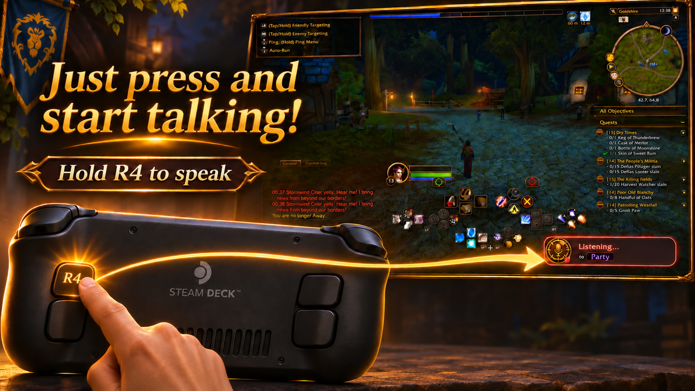
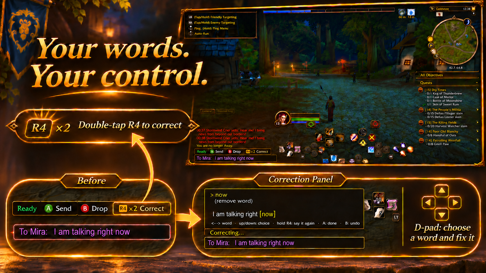
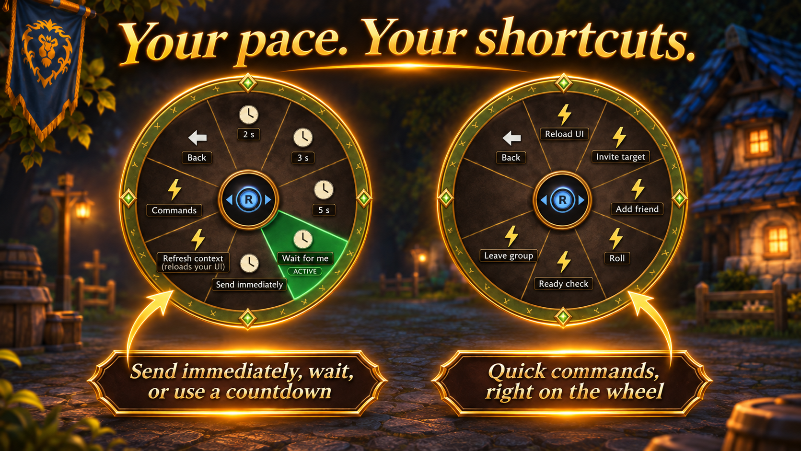

# My Steam Deck Gets Me

**Talk to your party without taking your hands off the Steam Deck.**

Open-source voice-to-text for **WoW Forever**. Speak into the Deck’s built-in mic, and it transcribes your words locally. Your mic audio stays on your Deck.

[Install on your Steam Deck](#install) · [See the controls](#how-to-play) · [Compare test results](#test-results)

## Hold R4 and talk

Hold **R4**, say “Anyone up for Deadmines?”, and let go. Your words appear as text for your last chat destination.



## Pick who you’re talking to

Press **R4** twice and hold the second press to open the wheel. Aim with the right stick to pick Party, Guild, a friend, or another destination. Keep holding **R4** while you speak.


## Fix a word with the D-pad

Double-tap **R4** while a message is waiting. Use the **D-pad** to pick a word, then choose an alternative or remove it. Hold **R4** to say the word again.



## Send when you’re ready

Open **Options** on the wheel to send immediately, set a **2-, 3-, or 5-second countdown**, or choose **Wait for me** and press **A** when you’re ready. Press **B** to discard a message that’s waiting.



## How to play

| Gesture | What it does |
| --- | --- |
| **Hold R4**, speak, then release | Dictate to your last chat destination. The listening card shows where your message is going. |
| **Press R4 twice and hold the second press** | Open the destination wheel. Aim with the right stick to pick Say, Party, Guild, a whisper, or another destination. Keep holding R4 while you speak. |
| **Double-tap R4** while a message is waiting | Open the correction menu. Use the D-pad to select a word and cycle through alternatives or remove it. Hold **R4** to say the word again. |
| **Press A** or **tap R4** while a message is waiting | Send it now. Press **B** to discard it. |

Open **Options** on the wheel to send immediately, wait for you to press send, or use a **2-, 3-, or 5-second countdown**. The default countdown is 2 seconds.

## Install

You’ll need a **Steam Deck running SteamOS**, **WoW Forever** (the Classic-based World of Warcraft client) set up through Battle.net as a non-Steam game with Proton, and about **2 GB of free space**. Dictation is in English. The tool was tested on a Steam Deck OLED and can be used in Game Mode or Desktop Mode.

Switch to **Desktop Mode**, open **Konsole**, and run:

```bash
git clone https://github.com/yerenutku/my-steam-deck-gets-me.git ~/my-steam-deck-gets-me && bash ~/my-steam-deck-gets-me/install.sh
```

The installer sets up the SteamOS companion and the in-game addon. It also offers to configure Steam Input so the right stick can aim at the wheel without turning the camera. Launch WoW, wait for **Voice ready**, then hold **R4** and say something. [Full installation guide](docs/install.md)

## Test results

We tested six speech models and five engines across **93 WoW chat recordings** from one player using the built-in mic on a Steam Deck OLED. We compared Decktation’s transcription setup and Voxpression’s Whisper model. Voxpression also learns names and corrections in the app, which this test didn’t measure.

| Transcription setup | 51 lab lines | 28 fresh lines | 14 in-game dictations |
| --- | ---: | ---: | ---: |
| **My Steam Deck Gets Me** | **14.2%** | **9.4%** | **5.2%** |
| Decktation’s setup | 20.8% | 14.9% | 6.2% |
| Voxpression’s model | 33.5% | 20.3% | 15.5% |
| Voxpression’s model with a names prompt | 21.6% | 13.4% | — |

The table shows **word error rate**. Lower is better. We tuned on the lab lines and saved the fresh lines for a separate check. On those 28 fresh lines, our setup had **37% lower word error rate** than Decktation’s setup. The gap was smaller on the 14 in-game dictations.

<picture>
  <source media="(prefers-color-scheme: dark)" srcset="docs/charts/accuracy-dark.png">
  
</picture>

**What made the difference?** The names correction step helps with player names and WoW terms. With the same Parakeet setup, it brought the fresh-set error rate from **13.4% to 9.4%**. Running Parakeet on the Deck’s GPU took about **0.3 seconds of compute per line**, compared with about **1.3 seconds** for Decktation’s CPU setup. In live use, text appeared about **one second after releasing R4**.

### Speed and in-game frame rate

<picture>
  <source media="(prefers-color-scheme: dark)" srcset="docs/charts/speed-dark.png">
  
</picture>

Qwen3-ASR was more accurate on the fresh set (**7.4%** word error rate). It took about **3–5 seconds** per line with WoW running, which is why we shipped the faster Parakeet setup.

<picture>
  <source media="(prefers-color-scheme: dark)" srcset="docs/charts/fps-dark.png">
  
</picture>

In our uncapped in-game test, WoW ran at **52–58 FPS** during Parakeet transcription. The slowest frame took **37 ms**.

[Full lab report](docs/lab-report.md) · [Run the tests yourself](docs/run-the-tests.md)

## Recognition and privacy

Recognition uses an English speech model on the Deck’s GPU and a word list to help with WoW terms such as **Deadmines** and **Ironforge**. You can add your friends’ and guildmates’ names to `service/names.txt`.

Speech recognition runs locally. The tool keeps audio and transcripts for up to 200 recent dictations in `service/history/` on your Deck. You can delete those files any time.

## Credits and license

Built by a WoW player together with Claude (Anthropic). The project code is [MIT licensed](LICENSE).

- Speech recognition uses NVIDIA Parakeet unified-en 0.6B (CC BY 4.0), the [GGUF build by handy-computer](https://huggingface.co/handy-computer/parakeet-unified-en-0-6b-gguf), and [transcribe.cpp](https://pypi.org/project/transcribe-cpp/) on Vulkan.
- Pause detection uses Silero VAD (MIT) through sherpa-onnx (Apache 2.0).
- The Deck’s button positions in the controller data come from [Decktation](https://github.com/silverfoxy/decktation) (MIT). The common-word list uses OpenAI Whisper’s tokenizer (MIT).

Created independently of Blizzard Entertainment and Valve.
