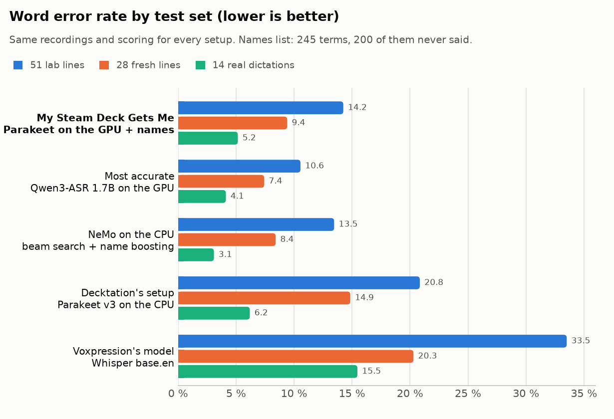
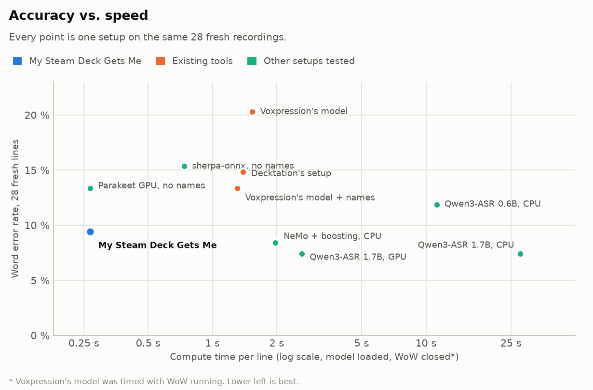
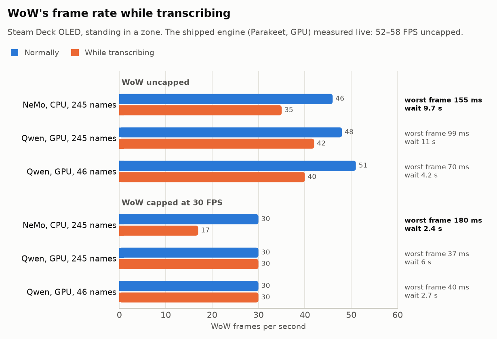

# Lab report: accurate local voice dictation for WoW Forever on a Steam Deck

*November 2026. One player, one Steam Deck OLED, its built-in microphone, 93 recorded lines and 77 test runs.*

## Summary

We wanted push-to-talk dictation into World of Warcraft (WoW Forever, a Classic-based client) on a Steam
Deck, running entirely on the device, with **accuracy as the first priority** and speed second. We compared
six speech models, five inference engines and many settings on the player's own voice, checked the results
for overfitting, measured the effect on the game's frame rate, and compared against two existing dictation
tools for the Deck.

The configuration we shipped:

| | |
|---|---|
| Model | NVIDIA **Parakeet unified-en 0.6B** (English only), F16 |
| Engine | **transcribe.cpp** on the Deck's GPU through **Vulkan** |
| Names | a small post-processing step that snaps misheard names to a list of names and WoW terms |
| Result | **14.2 % / 9.4 % / 5.2 % word error rate** on our three test sets, **~0.3 s** of compute per line, **~1.1 s** from releasing the button to the text being in chat |

Word error rate (WER) on the three test sets, lower is better:

| Setup | 51 lab lines | 28 fresh lines | 14 real dictations | Compute per line |
|---|---|---|---|---|
| **Shipped:** Parakeet unified-en, GPU (Vulkan) + names correction | **14.2 %** | **9.4 %** | **5.2 %** | **0.3 s** |
| Most accurate: Qwen3-ASR 1.7B, GPU (Vulkan), names as context | 10.0–10.6 % | 7.4 % | 4.1 % | 1.2–2.7 s |
| NeMo + Parakeet unified-en, CPU, beam search + name boosting | 13.5 % | 8.4 % | 3.1 % | 2.0 s |
| Decktation's setup (Parakeet v3, transcribe.cpp, CPU) | 20.8 % | 14.9 % | 6.2 % | 1.3 s |
| Voxpression's model (Whisper base.en), plain | 33.5 % | 20.3 % | 15.5 % | ~1.0 s |
| Voxpression's model with a names prompt | 21.6 % | 13.4 % | – | ~1.4 s |

<picture>
  <source media="(prefers-color-scheme: dark)" srcset="charts/accuracy-dark.png">
  
</picture>

<picture>
  <source media="(prefers-color-scheme: dark)" srcset="charts/speed-dark.png">
  
</picture>

The most important findings:

1. **Names matter more than the model.** Without help, every model misheard WoW names and player names. Telling
   the recognizer which names to expect cut errors by about a third, more than any change of model or engine.
2. **English-only models beat multilingual ones** by a wide margin for this (non-native) English speaker.
3. **How a model is run matters as much as which model.** The same Parakeet v3 model scored 30.6 % in one engine
   and 20.8 % in another.
4. **On the Deck, the GPU only works through Vulkan.** AMD's compute stack (ROCm/PyTorch) gave silently wrong
   results on the Deck's GPU.
5. **The game is the real limit.** An uncapped WoW uses ~98 % of the GPU and ~87 % of the CPU by itself; any
   dictation then fights the game. A light model on the GPU costs nothing visible; a heavy one or a CPU one
   makes the game stutter or wait seconds.
6. Cutting silence, splitting at pauses and live streaming all **lost** accuracy or speed on this hardware.

The most accurate option (Qwen3-ASR 1.7B) was not shipped: in the game it took 3–5 s per line, which the
player found too slow. Accuracy first, but not at any wait.

---

## 1. The question

- **Goal:** hold a button, speak, release, and the text appears in WoW's chat. Chat channel and recipient are
  picked from an in-game radial menu, not by voice.
- **Priorities:** accuracy first, then speed. English only was acceptable if it was more accurate.
- **Constraints:** everything on the device, no cloud. The Deck's built-in microphone. Played in Game Mode.
- **Hard part:** game vocabulary (dungeons, zones, items, abbreviations like LFM/WTS) and player names, said
  by a non-native English speaker, through a handheld's microphone, while the game is running.

**Model vs. engine.** A *model* is the trained network (for example Parakeet or Whisper). An *engine* is the
program that runs it (NeMo, sherpa-onnx, faster-whisper, transcribe.cpp, CrispASR). The same model can perform
differently in different engines (precision, decoding method, features such as name boosting).

## 2. Setup

### Hardware and software

| | |
|---|---|
| Device | Steam Deck OLED ("Galileo"): AMD Custom APU 0932, 4 cores / 8 threads, RDNA2 GPU (gfx1033), 16 GB shared memory |
| OS | SteamOS 3.9.5 (build 20261023.100), kernel 7.2.7-valve, Mesa RADV Vulkan driver |
| Microphone | the Deck's internal microphone, 48 kHz mono, resampled to 16 kHz |
| Game | WoW Forever under Proton |
| Python engines | NeMo 3.0.0 (PyTorch 2.15 CPU), sherpa-onnx 2.0.2 (onnxruntime 1.32), faster-whisper 1.2.1 (CTranslate2 4.9), transformers 5.24 |
| Native engines | transcribe.cpp 0.4.2 (Python bindings, Vulkan build), CrispASR 0.8.55 (Vulkan build) |

CPU tests used 4 threads. Unless noted otherwise, engine tests ran with WoW closed.

### Test sets

All recordings are the same player, recorded with a small recorder tool: hold a key, read the line, release.
The recorder keeps 0.5 s from before the key press and 0.3 s after the release, so no word is clipped.

| Set | Lines | Content |
|---|---|---|
| **Lab** | 51 | typical WoW chat written for the test: dungeons, zones, items, abbreviations (LFM, LF2M, WTS, brb), numbers; 11 lines with real names of the player's friends and characters |
| **Fresh** | 28 | recorded later, never used for tuning: 20 new lines by us, 8 in the player's own words |
| **Real use** | 14 | actual dictations from the finished tool, with the player's own corrections as reference |

Recordings were made with WoW running and its sound muted (realistic fan noise). The recordings are not
published: they are a real person's voice.

### Names lists

| List | Size | Use |
|---|---|---|
| Small | 46 terms | exactly the names, places, items and abbreviations used in the lab lines |
| **Big** | 245 terms | the small list plus 200 terms that are never said: invented player names, common Turkish and Dutch first names, all zones and dungeons, more items and abbreviations |

The big list is the realistic one: in real use the list holds a whole guild and friends list, and most of it
is not said in any given line. It also tests the main risk of name boosting: names that are written although
nobody said them.

### Scoring

- **WER (word error rate):** word-level edit distance between the transcript and the reference, divided by the
  number of reference words. Before comparing, both are lowercased, punctuation is removed, number words become
  digits ("twenty five" → 25) and spelled-out letters are joined ("L F 2 M" → lf2m).
- **Exact:** share of lines without a single error.
- **Names:** how many of the names and terms in the reference come out right.
- **False:** list terms that appear in the transcript but were not said (wrongly inserted names).
- **Seconds per line:** compute time from the end of the audio to the text, with the model already loaded.

Notes on the numbers:
- "I'm" transcribed as "I am" counts as two errors although the meaning is the same. Several models do this;
  about 2 points of the fresh-set WER come from it.
- Timings are indicative. Some runs had background load (the desktop's file indexer, or WoW running); those
  are marked.

## 3. Experiments, in the order we ran them

### 3.1 Which model? (CPU, sherpa-onnx, int8, no names)

| Model | Languages | WER (lab) | Exact | Names | s/line |
|---|---|---|---|---|---|
| Parakeet unified-en 0.6B | English | 21.1 % | 22 % | 24/56 | 0.79 |
| Parakeet TDT 0.6B v2 | English | 21.4 % | 25 % | 22/56 | 0.83 |
| Parakeet Ultra (a post-trained v3) | 25 European | 28.5 % | 20 % | 17/56 | 0.81 |
| Parakeet TDT 0.6B v3 | 25 European | 30.6 % | 18 % | 13/56 | 0.83 |

**English-only models were clearly better** for this speaker. Without any names help, about half the names
were wrong in every model.

### 3.2 Does the engine or precision matter? (Parakeet v2)

| Engine, precision | WER (lab) | s/line |
|---|---|---|
| sherpa-onnx, int8 | 21.4 % | 0.83 |
| NeMo, full precision (fp32) | 22.4 % | 1.40 |

**No accuracy gain from full precision**; the int8 build was ~1.7× faster. Engines matter for *features*
(name boosting, beam search), not for raw accuracy here.

### 3.3 Name boosting and beam search (NeMo, CPU)

NeMo's "boosting tree" raises the score of listed phrases while decoding. Beam search keeps several candidate
transcripts instead of one.

| Setup (Parakeet unified-en unless noted) | WER (lab) | Exact | Names | False | s/line |
|---|---|---|---|---|---|
| greedy, no names (NeMo v2 for reference) | 22.4 % | 24 % | 20/56 | 0 | 1.40 |
| greedy + boosting | 14.8 % | 39 % | 41/56 | 0 | 1.42 |
| **beam 4 + boosting (alpha 1)** | **12.9 %** | **45 %** | 44/56 | 0 | 1.86 |
| beam 4 + boosting, alpha 0.5 | 15.0 % | 39 % | 37/56 | 0 | 1.92 |
| beam 4 + boosting, alpha 2 | 16.6 % | 37 % | 47/56 | **8** | 1.88 |
| Parakeet v2, beam 4 + boosting | 15.3 % | 39 % | 40/56 | 0 | 1.35 |

- **Boosting was the largest single gain** (about −7 points). Beam search added about −2.
- **The boost strength matters:** too weak misses names; too strong finds more names but also writes names
  nobody said (8 false insertions at alpha 2).
- The same idea in sherpa-onnx ("hotwords" with modified beam search) was slower and less accurate:

| sherpa-onnx hotwords, score | WER | Names | s/line |
|---|---|---|---|
| 1.5 | 17.7 % | 35/56 | 3.17 |
| 2.5 | 16.4 % | 42/56 | 3.20 |
| 3.5 | 15.0 % | 45/56 | 3.15 |

### 3.4 Cutting silence and splitting at pauses

The player starts speaking about 1–1.5 s after pressing the button. Cutting the silence (or transcribing
phrase by phrase while still talking) could save time. We used the Silero VAD to find speech.

| Setup (NeMo unified-en, beam 4, boosting) | WER | s/line |
|---|---|---|
| whole recording | **12.9 %** | 1.86 |
| trim silence, 0.15 s padding | 16.6 % | 1.28 |
| trim silence, 0.5 / 0.3 s padding | 15.0 % | 1.40 |
| split at pauses, 0.15 s padding (time = last piece only) | 18.7 % | 1.11 |
| split at pauses, 0.5 / 0.3 s padding | 16.1 % | 1.22 |

**Both hurt.** The VAD missed the player's soft word starts ("Who is pulling" → "pulling"); even with generous
padding, accuracy dropped by 2 or more points. Parakeet did best on the complete recording.

### 3.5 Live streaming

Parakeet unified-en can also stream (transcribe while you talk). In sherpa-onnx with 560 ms chunks on the CPU
it needed **2.3–3 s of compute per second of speech**: it could not keep up live, and the wait after releasing
was 2.8–3.7 s. Stopped.

### 3.6 Whisper for comparison

| Setup | WER (lab) | Exact | Names | False | s/line |
|---|---|---|---|---|---|
| Whisper large-v3-turbo (faster-whisper, int8, beam 5) + names in the prompt | 13.5 % | 39 % | 46/56 | 1 | **11.45** |

As accurate as the best NeMo setup, but **six times slower** on the CPU.

### 3.7 Robustness check 1: a realistic names list

The 12.9 % above used a names list that contains exactly the names in the lines. With the big list
(245 terms, 200 never said):

| Setup | WER (lab) | Exact | Names | False | s/line |
|---|---|---|---|---|---|
| NeMo unified-en, beam 4, boosting, big list | 13.5 % | 43 % | 43/56 | 1 | 1.97 |
| same, greedy | 16.4 % | 37 % | 39/56 | 2 | 1.32 |

Boosting **held up** (+0.6 points), and beam search mattered more with a long list. The one false insertion
shows the real risk: a list name that sounds like a normal word ("selling" became the first name "Selin").

### 3.8 Robustness check 2: fresh recordings

Everything so far was tuned on the 51 lab lines. On 28 new lines (8 of them in the player's own words):

| Setup | WER (fresh) | Exact | Names | False | s/line |
|---|---|---|---|---|---|
| NeMo unified-en, beam 4, boosting (big list) | **8.4 %** | 57 % | 14/20 | 0 | 1.97 |
| same, boost alpha 0.7 | 9.4 % | 54 % | 12/20 | 0 | 1.96 |
| same, no boosting | 13.4 % | 46 % | 6/20 | 0 | 1.65 |
| sherpa unified-en int8, greedy | 15.3 % | 46 % | 6/20 | 0 | 0.74 |
| sherpa v3 int8, greedy | 18.8 % | 39 % | 5/20 | 0 | 0.72 |

**No overfitting:** the tuned setup did even better on unseen lines, and boosting again was worth ~5 points.

### 3.9 A larger model: Qwen3-ASR (CPU)

Qwen3-ASR is a speech model with a language-model decoder. Instead of boosting, it accepts names as free text
context ("Vocabulary: …"). Run with Hugging Face transformers on the CPU:

| Setup | WER (fresh) | Exact | Names | s/line |
|---|---|---|---|---|
| Qwen3-ASR 1.7B, names as context | **7.4 %** | **64 %** | 15/20 | **27.6** |
| Qwen3-ASR 0.6B, names as context | 11.9 % | 57 % | 13/20 | 11.2 |

The most accurate result so far, but far too slow on the CPU.

### 3.10 The GPU, attempt 1: AMD ROCm / PyTorch (failed)

The Deck's GPU is an RDNA2 "gfx1033". What we found:

- **PyTorch's official ROCm builds** contain no gfx1033 code. With the usual workaround (`HSA_OVERRIDE_GFX_VERSION=10.3.0`),
  a simple test computed **1 + 1 = 0**.
- **AMD's own build for this GPU family** (`gfx103X-all`, PyTorch 2.11 + ROCm 7.13) does contain gfx1033 code.
  It ran, but gave **silently wrong results that changed from run to run**: half-precision matrix products,
  the attention operation, sometimes even filling a tensor or counting. Batched matrix multiplication **hung**
  twice. Disabling the copy engine (`HSA_ENABLE_SDMA=0`) changed nothing.
- Other projects hit the same problem: the Unsloth project blocks gfx1033 on ROCm because of NaN results on
  AMD's native build, and points AMD users to Vulkan.

**Conclusion:** on the Deck, compute on the GPU only through Vulkan, the driver games use.

### 3.11 The GPU, attempt 2: Vulkan

Two engines have prebuilt Vulkan versions for Linux: **transcribe.cpp** and **CrispASR**.

| Setup | WER lab | WER fresh | Names (lab) | False (lab) | s/line |
|---|---|---|---|---|---|
| Qwen3-ASR 1.7B Q8, transcribe.cpp, names as context (245 terms) | 10.6 % | 7.4 % | 44/56 | 0 | 2.62–2.65 |
| same, small context (46 terms) | **10.0 %** | – | **48/56** | 0 | 1.17 |
| Qwen3-ASR 1.7B Q8, CrispASR, names as context | – | 7.4 % | – | – | 4.38 |
| Qwen3-ASR 1.7B Q8, CrispASR, no context | – | 12.4 % | – | – | 1.79 |
| Parakeet unified-en F16, transcribe.cpp | 20.6 % | 13.4 % | 24/56 | 0 | **0.27–0.28** |
| Parakeet unified-en F16, CrispASR, greedy | – | 13.9 % | – | – | 0.78 |

- **Qwen on the GPU kept its accuracy and became ~10× faster** (27.6 s → 2.6 s). The names context costs time
  every line: about 0.7 s per 100 terms. A short list (1.2 s) beats a long one.
- **Parakeet on the GPU took 0.27 s per line**, but transcribe.cpp offers no name boosting for it.
- **transcribe.cpp was the faster engine** on this GPU: 1.7× for Qwen, about 3× for Parakeet.
- **CrispASR's name boosting for Parakeet did nothing at first.** Its hotword tokenizer ignores the
  SentencePiece word-start marker, so a name never matches what the model produces. Adding the marker to the
  names ourselves made it work, but it is a plain per-token bonus, much cruder than NeMo's boosting tree:

| CrispASR Parakeet, beam 4, boost | WER lab | WER fresh | Names (lab) | False (lab) |
|---|---|---|---|---|
| no effect (before the fix), any strength | – | 13.9 % | – | – |
| strength 3 (with the fix) | 21.4 % | 12.4 % | 28/56 | 0 |
| strength 5 (with the fix) | 35.9 % | 23.8 % | 29/56 | **27** |

### 3.12 Dictating while the game runs

<picture>
  <source media="(prefers-color-scheme: dark)" srcset="charts/fps-dark.png">
  
</picture>

We measured WoW's frame rate with a small addon that records the duration of every frame, and lined it up
with the dictation tool's timestamps. Each setup transcribed recordings every few seconds while the player
stood in the game.

| Setup | WoW FPS normally → while transcribing | Worst frame | Transcription time |
|---|---|---|---|
| uncapped, NeMo on the CPU, 245 names | 46 → 35 | 155 ms | 9.7 s |
| uncapped, Qwen on the GPU, 245 names | 48 → 42 | 99 ms | 11.0 s |
| uncapped, Qwen on the GPU, 46 names | 51 → 40 | 70 ms | 4.2 s |
| FPS capped at 30, NeMo on the CPU | 30 → **17** | **180 ms** | 2.4 s |
| FPS capped at 30, Qwen on the GPU, 245 names | 30 → 30 | 37 ms | 6.0 s |
| FPS capped at 30, Qwen on the GPU, 46 names | **30 → 30** | 40 ms | 2.7 s |

- **Uncapped, WoW alone keeps the GPU ~98 % and the CPU ~87 % busy.** Every engine became 3–5× slower in the game.
- With a 30 FPS cap, the GPU route cost the game nothing measurable. **The CPU route made the game stutter**,
  because with a cap the CPU is the game's bottleneck.
- The GPU and CPU load of every run is kept (`results-game/*.csv`, every 0.1 s). The per-frame data of WoW
  from these runs no longer exists (the logging addon keeps a rolling buffer); the FPS figures above are its
  summary, taken at the time.

### 3.13 Real use: Qwen was too slow in the game

In the first real tests the player used the finished tool with Qwen on the GPU. It was accurate, but took
**3.2–4.6 s per line** with WoW uncapped, and the player found it too slow. The same recordings through
Parakeet on the GPU, with WoW running, took **0.35–0.6 s** with nearly identical text. We switched to Parakeet
and looked for another way to handle names.

### 3.14 Names without boosting: a correction step after transcription

For the fast engine we added a small post-processing step:
- A run of 1–3 words whose letters, joined, equal a listed term is replaced ("dead mines" → Deadmines,
  "Iron Forge" → Ironforge).
- Otherwise a close spelling match (edit distance) is allowed only if the words are not plain common English
  words written in lowercase. A capitalised word in mid-sentence is one the model itself took for a name, so it
  may be corrected ("Ogrimar" → Orgrimmar). A list of ~20,000 common English words (taken from Whisper's
  tokenizer vocabulary) protects normal words, so "part" never becomes a name.
- A neighbouring word is only included if the match gets better with it ("to Ironforge" keeps its "to").

Results with the big list (245 terms):

| Setup | WER lab | WER fresh | WER real | False (all sets) |
|---|---|---|---|---|
| Parakeet unified-en, GPU | 20.6 % | 13.4 % | 8.2 % | 0 |
| **+ names correction** | **14.2 %** | **9.4 %** | **5.2 %** | 1 in 93 lines |
| Decktation's setup | 20.8 % | 14.9 % | 6.2 % | 0 |
| Decktation's setup + our names correction | 15.3 % | 9.9 % | 4.1 % | 0 |

The step costs milliseconds and removed about a third of the errors, close to NeMo's boosting (13.5 % / 8.4 %
/ 3.1 %) at a fraction of the time. The one false correction again involved a name that sounds like a normal
word.

### 3.15 Comparison with existing tools

We compared against two dictation tools for the Deck that the player had installed. We tested their
**models** in their own or equivalent engines, **not the complete applications**.

- **Decktation** (open source) runs Parakeet TDT 0.6B v3, Q8, in transcribe.cpp on the CPU, greedy, without names.
- **Voxpression** (commercial) uses Whisper base.en (faster-whisper). The application also learns player names and
  corrections over time; we did not reproduce that part, so its real-world accuracy is likely better than its
  model alone.

| | WER lab | WER fresh | WER real | Names (lab) | False (lab) | s/line |
|---|---|---|---|---|---|---|
| Decktation's setup (exact model file and engine) | 20.8 % | 14.9 % | 6.2 % | 21/56 | 0 | 1.1–1.4 |
| Voxpression's model, plain | 33.5 % | 20.3 % | 15.5 % | 16/56 | 0 | ~1.0–1.6* |
| Voxpression's model, names as prompt | 21.6 % | 13.4 % | – | 43/56 | 6 | ~1.4* |
| **Ours (shipped)** | **14.2 %** | **9.4 %** | **5.2 %** | 40/56 | 1 | **0.3** |

\* measured with WoW running.

**A correction we made along the way:** we first compared against Parakeet v3 run through sherpa-onnx (int8),
which scored 30.6 %, and concluded our setup made "a third of Decktation's errors". The player's experience
disagreed. Running **Decktation's own model file in Decktation's own engine** gave 20.8 %: the same accuracy
as our fast engine without names. The real difference comes from the names step.

In a side-by-side test in the game (one button for each tool), Decktation needed 0.8–1.4 s from releasing the
button to the text being sent; ours 1.2–1.7 s at first. Removing overhead around the model (typing speed, a
silence check run in parallel instead of before) brought ours to about 1.0–1.25 s.

### 3.16 Final configuration

| | |
|---|---|
| Model and engine | Parakeet unified-en 0.6B, F16, transcribe.cpp on the GPU (Vulkan) |
| Names | correction step against ~120 terms (the player's friends plus WoW places, dungeons, items, abbreviations) |
| Silence | a silence check (Silero VAD) runs next to the transcription; recordings without speech are dropped |
| Measured | 0.3 s compute per line; **1.0–1.25 s from release to text in chat**; WoW kept **52–58 FPS** (uncapped) while transcribing, worst frame ≤ 37 ms |

## 4. Lessons

1. **Give the recognizer the names.** It is the biggest lever: boosting in the decoder (NeMo), context text
   (Qwen) or a correction step afterwards. Measure **wrongly inserted names** as well, not just found names:
   stronger boosting finds more names but starts inventing them.
2. **Test the configuration, not only the model.** The same model differed by 10 points between two engines.
   Compare against other tools using their exact setup.
3. **Keep a held-out set.** Our tuned setup could have been overfitted to the lab lines; the fresh set showed it
   was not. Real dictations from use were the most informative set of all.
4. **Accuracy vs. speed is decided in the game, not in the lab.** Lab timings with the game closed were 3–5×
   too optimistic.
5. **On the Steam Deck, use Vulkan for GPU compute.** ROCm on gfx1033 gives silent wrong results.
6. **Simple tricks can backfire.** Silence trimming cut off soft word starts; streaming could not keep up on
   the CPU; a "dead microphone" watchdog mistook the codec's noise gate (exact zeros in a quiet room) for a
   failure.

## 5. Limitations

- **One speaker, one device, one microphone.** Results for other voices, accents or headsets may differ.
- **Small sets:** 51 + 28 + 14 lines. Differences of one or two points, especially on the 14-line set, are
  within noise.
- **Quiet conditions:** recordings had the game muted. Game sound from the speakers was not tested.
- **The lab set was used for tuning;** the fresh and real-use sets are the fairer measures.
- **Timings are indicative:** some runs had background load.
- **Existing tools were compared by their models,** not as complete applications.

## 6. Reproducing

The test scripts are in `lab/`:

| Script | Purpose |
|---|---|
| `record.py` | recorder: shows a line, hold Space to record it (0.5 s pre-roll, 0.3 s tail) |
| `run_sherpa.py`, `run_nemo.py`, `run_whisper.py`, `run_qwen.py`, `run_transcribe.py`, `run_crisp.py` | one runner per engine; each writes one JSON file per run with every transcript and its timing |
| `make_charts.py` | draws the charts in `charts/` from the results (light and dark) |
| `score.py` | scores all runs: WER, exact lines, names, false names, seconds per line (`--names FILE`, `--set NAME`) |
| `make_segments.py`, `run_sherpa_stream.py` | the silence-splitting and streaming experiments |
| `namefix_eval.py` | applies the names correction to existing runs |
| `gpu_check.py` | the GPU sanity checks used for the ROCm tests |
| `game_test.py`, `game_series.sh`, `fps_analyze.py` | the in-game measurements (with a frame-time logging addon) |

To reproduce with your own voice, see **[Run the tests yourself](run-the-tests.md)**. The recordings and transcripts of this report are not
published: they contain a real person's voice and the names of real people.

## 7. Credits

Speech models: NVIDIA Parakeet (TDT v2, v3, unified-en), Moondream Parakeet Ultra, Qwen3-ASR (Alibaba Qwen
team), OpenAI Whisper. Engines and tools: NVIDIA NeMo, sherpa-onnx (k2-fsa), faster-whisper / CTranslate2,
Hugging Face transformers, transcribe.cpp (handy-computer), CrispASR, Silero VAD. Comparisons: Decktation,
Voxpression. Please check each project's licence before redistributing any of them; several models require
attribution.

The lab work was done by the player together with Claude (Anthropic) as a coding assistant.
